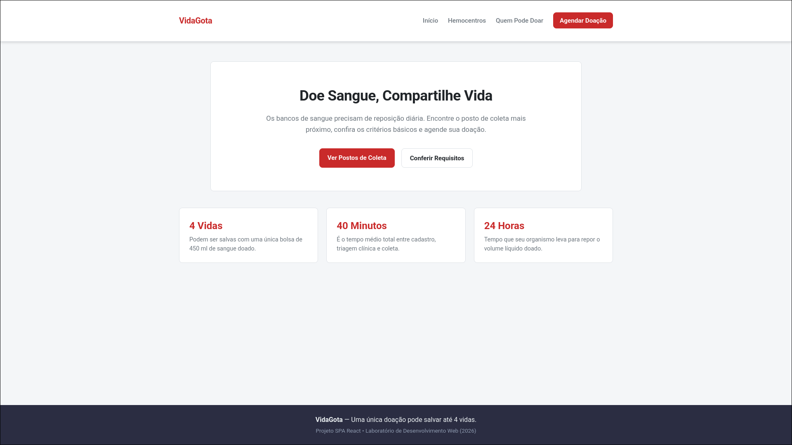

<h1 align="center"> Vida Gota </h1>

Project made for training web technologies

  <a href="#-technologies">Technologies</a>&nbsp;&nbsp;&nbsp;|&nbsp;&nbsp;&nbsp;
  <a href="#-project">Project</a>&nbsp;&nbsp;&nbsp;&nbsp;&nbsp;&nbsp;

  

 

## 🚀 Technologies

- HTML & CSS
- React
- JavaScript
- Git & GitHub

## 💻 Project

VidaGota is a a page to show places to donate blood and simulate a reservation:

- [Access the final project online](https://joao-g.github.io/VidaGotaSPA)

---

Made with ♥ by joao-g :wave: 

